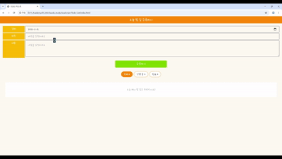
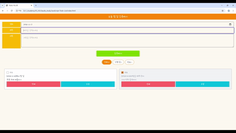
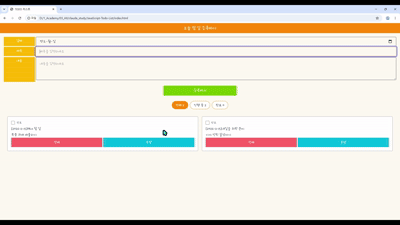
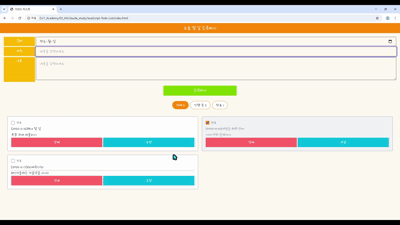
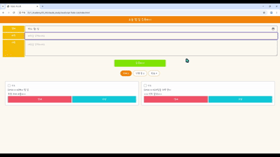
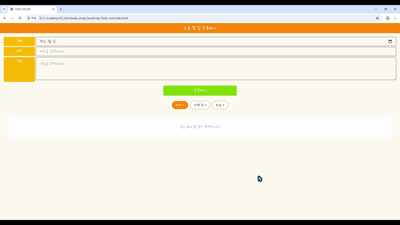
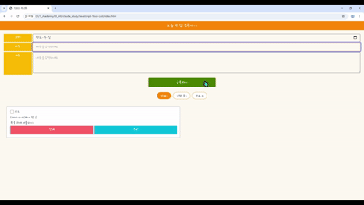

# 📝 JavaScript Todo 리스트

순수 JavaScript로 만든 할 일 관리 앱입니다.
할 일을 **등록·수정·삭제·조회**할 수 있고, 데이터는 브라우저 `localStorage`에 저장되어 새로고침해도 유지됩니다.

> KANT 프론트엔드 개발 과제 2 — Todo 리스트 만들기 (JavaScript)

<br>

## 🎬 시연 영상

> 브라우저 전체 시연 영상 (1분 53초)


https://github.com/user-attachments/assets/a08f600c-d0ba-407c-b3d3-b25bfd54c757


<br>

## ✨ 주요 기능

| 기능 | 설명 |
| --- | --- |
| 등록 | 날짜·제목·내용을 입력해 할 일 추가 |
| 수정 | 수정 버튼을 누르면 양식에 기존 값이 채워지고, 수정하기로 반영 (취소 가능) |
| 삭제 | 확인창에서 확인을 누르면 삭제 |
| 조회 | 완료 체크, 전체 / 진행 중 / 완료 필터와 필터별 개수 표시 |
| 입력값 검증 | 빈 값이나 공백만 입력하면 안내창 표시 |
| 저장 | `localStorage`에 저장되어 새로고침해도 목록 유지 |

### 1. 할 일 등록

| 빈 목록에서 등록 | 기존 목록에 추가 등록 |
| :---: | :---: |
|  |  |

### 2. 할 일 수정 · 삭제

| 수정 | 삭제 |
| :---: | :---: |
|  |  |

- 수정 중인 할 일은 테두리로 강조되고, 제출 버튼이 `수정하기`로 바뀌며 `취소` 버튼이 나타납니다.
- 삭제는 확인창(`confirm`)에서 한 번 더 확인합니다.

### 3. 할 일 조회 (완료 체크 · 필터)

| 완료 체크 + 필터 | 빈 목록 필터 안내 |
| :---: | :---: |
|  |  |

- 완료한 할 일은 취소선과 회색 배경으로 표시됩니다.
- 필터 버튼에 필터별 개수가 표시되고, 조건에 맞는 할 일이 없으면 필터에 맞는 안내 문구가 나옵니다.

### 4. 입력값 검증



<br>

## 🛠 기술 스택

| 구분 | 사용 기술 |
| --- | --- |
| 마크업 | HTML5 (`<template>` 역할의 `<script type="text/html">`) |
| 스타일 | Tailwind CSS v4.3.3 (CDN) + `css/style.css` 공통 스타일, Google Fonts `Gamja Flower` |
| 로직 | JavaScript (ES6+, 라이브러리 없음) |
| 저장소 | `localStorage` |

<br>

## 📁 파일 구조

```
JavaScript-Todo-List
├── index.html        # 등록 양식, 필터 버튼, 목록, 할 일 템플릿
├── css
│   └── style.css     # 공통 스타일 (글꼴·색상 변수, 포커스, 완료 카드, 빈 목록 문구 등)
├── js
│   └── todo.js       # 데이터 처리, 화면 렌더링, 이벤트 처리
└── docs
    ├── gif           # README 기능별 시연 GIF
    └── video         # 전체 시연 영상 (demo.mp4)
```

<br>

## ▶️ 실행 방법

별도 설치 없이 `index.html`을 브라우저로 열면 됩니다.

로컬 서버로 실행하려면:

```bash
python -m http.server 5500
```

브라우저에서 `http://localhost:5500` 접속

<br>

## 💡 구현 포인트

### 데이터 흐름

```
사용자 입력 / 클릭
   → add · update · remove · toggle   (items 배열 변경)
   → save()                           (localStorage에 JSON으로 저장)
   → render()                         (localStorage에서 읽어 필터 적용 후 화면 다시 그리기)
```

모든 데이터 변경이 같은 흐름(변경 → 저장 → 다시 그리기)을 거쳐서, 화면과 저장된 데이터가 항상 일치합니다.

### 과제 기준별 구현 내용

| 과제 기준 | 구현 내용 |
| --- | --- |
| **[필수] 작업 환경** | `index.html`, `css/style.css`, `js/todo.js` 3개 파일로 구성 |
| **[필수] 데이터 변환·로직** | 할 일을 객체 `{ uid, date, title, content, done }`로 다루고, `todo` 객체 하나에 데이터와 기능을 모음 |
| **[필수] 동적 UI (DOM & 이벤트)** | 템플릿으로 요소 생성, `innerHTML`로 목록 갱신, `createElement`로 취소 버튼 생성·`remove()`로 제거, `classList.toggle`로 강조 표시 |
| **[심화] 고차 함수 활용** | 아래 표 참고 |
| **[심화] 이벤트 처리 최적화** | 이벤트 위임, 템플릿 캐싱, `innerHTML` 한 번에 반영 |

### 고차 함수 활용

| 위치 | 사용한 함수 | 하는 일 |
| --- | --- | --- |
| `render()` | `filter()` → `map()` → `join("")` | 현재 필터에 맞는 할 일만 골라 HTML 문자열로 바꿔 한 번에 출력 |
| `renderFilters()` | `Object.entries()` → `map()` → `Object.fromEntries()` | 필터 조건 함수를 재사용해 필터별 개수 계산 |
| `renderItem()` | `replace()` 콜백 | 템플릿의 `${이름}` 자리를 값으로 치환 (모든 값은 이스케이프) |
| `update()`, `toggle()`, `remove()` | `find()`, `findIndex()` | uid로 대상 할 일 찾기 |
| submit 처리 | `Object.entries().find()`, `Object.keys().map()` | 비어 있는 첫 입력칸 찾기, 입력값 한 번에 읽기 |

필터는 조건 함수를 담은 설정 객체로 관리해서, 필터를 추가할 때 `filters`에 한 줄과 HTML 버튼 하나만 더하면 됩니다.

```js
filters: {
    all: { match: () => true, empty: "오늘 해야 할 일은 무엇인가요?" },
    active: { match: item => !item.done, empty: "진행 중인 할 일이 없어요." },
    done: { match: item => item.done, empty: "완료한 할 일이 없어요." },
},
```

### 이벤트 위임

삭제·수정 버튼마다 리스너를 붙이지 않고, 부모 요소에 리스너를 **한 번만** 등록합니다.
목록을 다시 그려도 부모는 그대로라서 리스너를 다시 등록할 필요가 없습니다.

| 부모 요소 | 이벤트 | 처리 |
| --- | --- | --- |
| `#todo-items` | `click` | `closest("button[data-uid]")`로 누른 버튼을 찾아 삭제 / 수정 |
| `#todo-items` | `change` | 완료 체크박스 토글 |
| `#todo-filters` | `click` | 필터 변경 |

### XSS 방지

사용자 입력을 `innerHTML`로 출력하기 전에 `& < > " '`를 HTML 엔티티로 바꿉니다.
`` 같은 값을 입력해도 태그로 실행되지 않고 글자 그대로 보입니다.

### 스타일 구조

- 화면 대부분은 Tailwind 유틸리티 클래스로 작성하고, `style.css`에는 Tailwind로 쓰기 번거로운 공통 스타일만 둡니다.
- `style.css`의 규칙을 Tailwind와 같은 `@layer` 안에 작성해서 Tailwind 클래스가 항상 우선 적용됩니다.
- 완료 카드 배경은 `:has(.toggle-action:checked)`로 CSS만으로 처리하고, 필터 선택 표시는 Tailwind `aria-pressed:*` 클래스로 처리해 JS는 상태 값만 바꿉니다.
- 키보드 포커스 표시(`:focus-visible`), `prefers-reduced-motion` 대응 등 접근성을 고려했습니다.

<br>

## 📌 작업 기록

이슈 → 브랜치 → PR 순서로 작업했습니다.

| PR | 작업 |
| --- | --- |
| [#2](https://github.com/jsa00/JavaScript-Todo-List/pull/2) | 초기 세팅 (이슈·PR 템플릿, 기본 파일) |
| [#4](https://github.com/jsa00/JavaScript-Todo-List/pull/4) | `.editorconfig` 추가 |
| [#6](https://github.com/jsa00/JavaScript-Todo-List/pull/6) | 목록 버튼 이벤트 위임 적용 |
| [#8](https://github.com/jsa00/JavaScript-Todo-List/pull/8) | 고차 함수로 렌더링 로직 정리, XSS 방지 |
| [#10](https://github.com/jsa00/JavaScript-Todo-List/pull/10) | 완료 토글, 필터 조회 기능 |
| [#12](https://github.com/jsa00/JavaScript-Todo-List/pull/12) | `style.css` 공통 스타일, 글꼴, CDN 버전 고정 |
